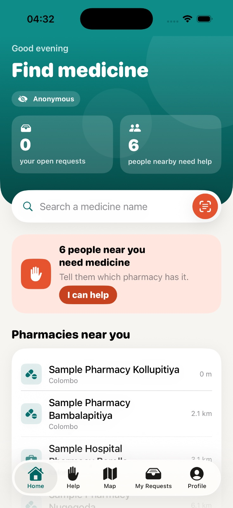
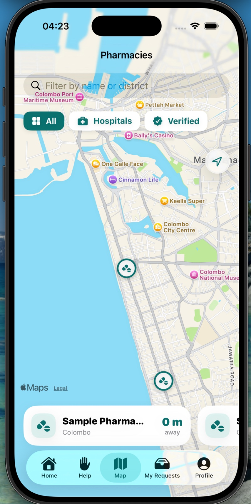
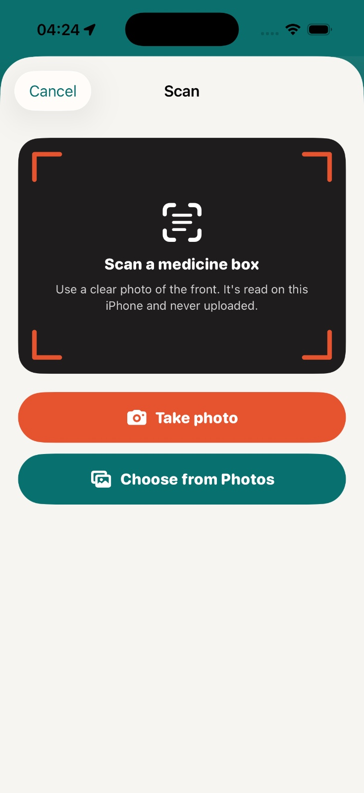
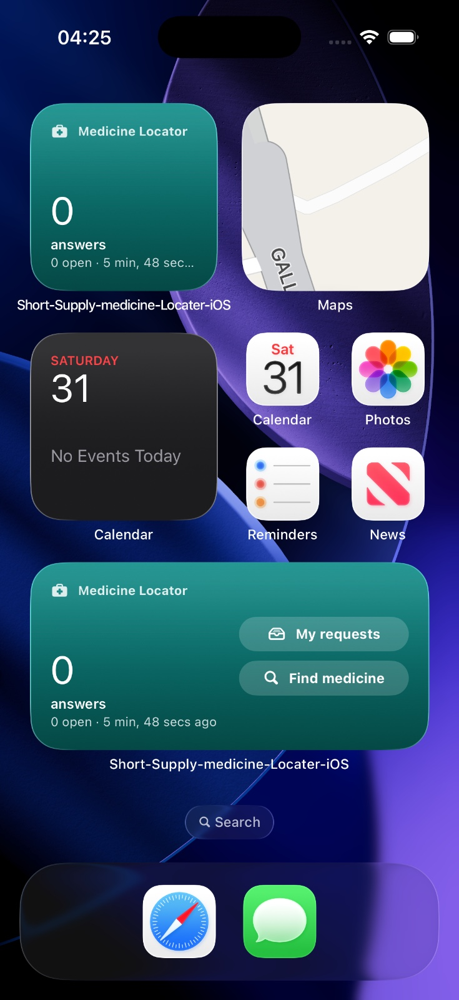
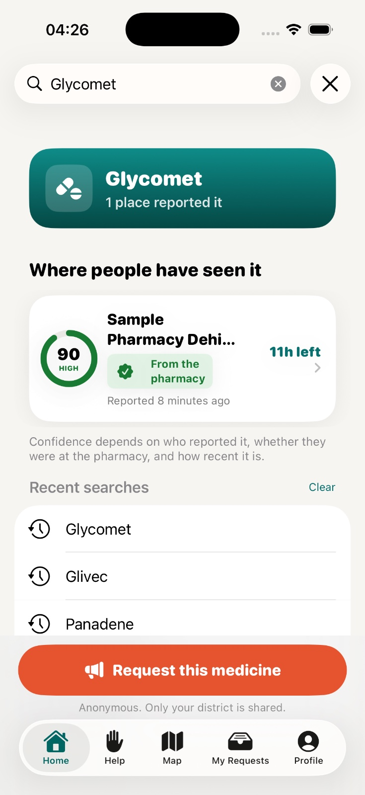

# Medicine Locator

An iPhone and iPad app that helps people in Sri Lanka find medicines in short supply, using availability reports from the community and verified pharmacies. Every answer gets a confidence score, and answers expire automatically so stale information disappears.

<!-- Screenshot: hero image — Home screen on iPhone next to the iPad sidebar layout -->
<p align="center">
  
</p>

## Features

- **Request a medicine** and get answers from members and verified pharmacies
- **Confidence scores** based on the source, on-site confirmations and age
- **On-site voting** that only counts within 100 m of the pharmacy
- **Reputation levels** for helpful members
- **Pharmacy verification** by moderators using the NMRA licence number
- **Anonymous use**, discreet notifications and a Face ID lock
- **Offline mode** with Core Data caching

### Advanced iOS features

| Feature | Framework |
| --- | --- |
| Pharmacy map with in-app directions (Apple Maps, falling back to OpenStreetMap) | MapKit, Core Location |
| Arrival prompts at the 20 nearest pharmacies | Core Location (`CLMonitor`) |
| Scan a medicine box to read its name, on device | Vision |
| Home and Lock Screen widget | WidgetKit |
| "Find a Medicine" and "Check My Requests" with Siri | App Intents |

<!-- Screenshots: map with a route, scan screen, widget, request with ranked answers -->
| Map and directions | Scan a box | Widget | Ranked answers |
| --- | --- | --- | --- |
|  |  |  |  |

## Requirements

- Xcode 26.2 or later
- iOS / iPadOS 26.2 or later (simulator or device)
- A Firebase project with Authentication (Anonymous + Email/Password) and Cloud Firestore enabled

## Setup

1. Clone the repository and open `Short-Supply-medicine-Locater-iOS.xcodeproj`.
2. Add `GoogleService-Info.plist` to the `Short-Supply-medicine-Locater-iOS` folder. It is not in Git for security; it is included in the submission ZIP.
3. Select your development team under **Signing & Capabilities** for the app and the widget targets. Both use the App Group `group.com.ad.MedicineLocator`.
4. Xcode fetches the Firebase package through Swift Package Manager on first build.
5. Run the **Short-Supply-medicine-Locater-iOS** scheme.

To test location features in the simulator, use **Features → Location → Custom Location** near Colombo (e.g. 6.911, 79.850).


## Running tests

Press **⌘U** in Xcode. The project has 198 unit tests written with **Swift Testing**, covering the business rules, ViewModels (using mock services) and utilities.

## Project structure

```
Short-Supply-medicine-Locater-iOS/
├── App/           App entry, ServiceContainer (dependency injection), IntentRouter
├── Models/        Data models and Rules/ (trust score, expiry, reputation…)
├── Services/      Firebase, Device, Local and Routing services + Protocols/
├── ViewModel/     One ViewModel per screen
├── Views/         SwiftUI screens, grouped by feature
├── Persistence/   Core Data model and cache
├── Intents/       Siri and Shortcuts
└── Utilities/     Theme, accessibility, formatters, deep links
MedicineLocatorWidget/              WidgetKit extension
Short-Supply-medicine-Locater-iOSTests/   Swift Testing unit tests
```

Architecture: **MVVM** with protocol-based services. Views talk to ViewModels, and ViewModels reach Firebase and Apple frameworks only through protocols.

## Known limitations

- The bundled pharmacy list is a 6-pharmacy sample, not the full NMRA list.
- No Cloud Functions or remote push (free plans only); the app uses Firestore rules, local notifications and background refresh instead.

## Credits

- Road routes © [OpenStreetMap](https://www.openstreetmap.org/copyright) contributors, via the OSRM public server
- Backend by [Firebase](https://firebase.google.com)

Built by Adheeb Ahamed for the iOS Application Development module, NIBM (BSCCOMP25.1P).
